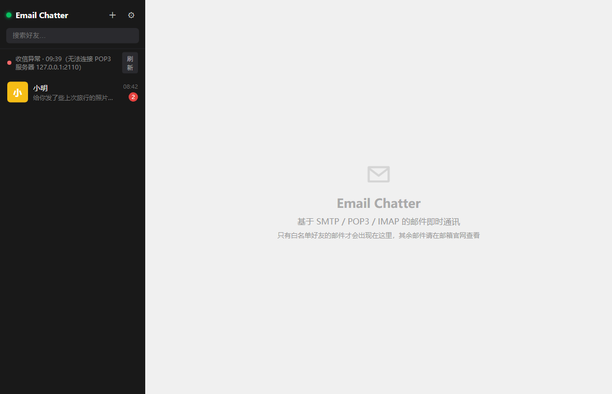
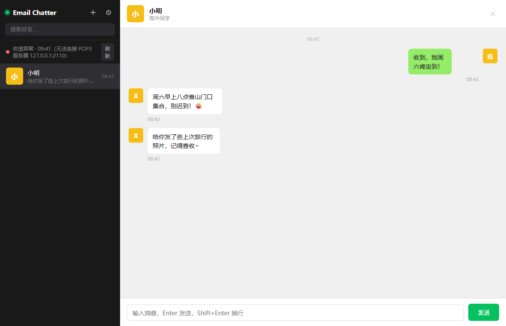
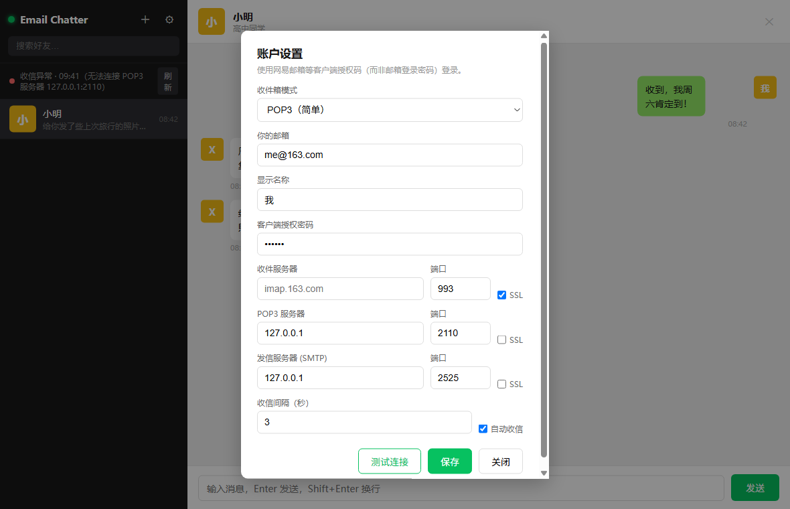
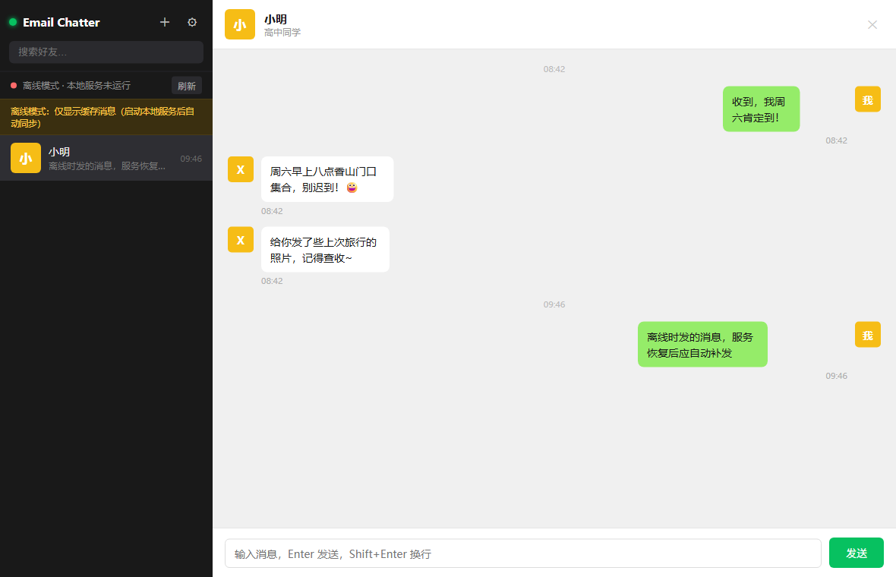

# Email Chatter · 邮件即时通讯

一个**类微信**的即时通讯客户端，但底层传输不是 IM 服务器，而是**电子邮件**。
它通过 **SMTP** 发信、**POP3 / IMAP** 收信，并且只处理**好友白名单**中的邮件——
白名单之外的来信会被忽略（请自行到邮箱官网查看）。

适用于网易 163/126、QQ 邮箱、Gmail、Outlook 等支持 POP3/IMAP/SMTP 的邮箱。
网易等非官方客户端需要使用**客户端授权密码**（不是登录密码）登录。

---

## 特性

- 👥 **好友白名单**：只显示、只处理白名单好友的邮件，其它邮件一律不进客户端，且在邮箱里**保持原样（不会被标为已读）**
- 💬 **微信风格界面**：左侧好友列表（**头像右上角红点未读数**、最后消息预览）、右侧会话气泡、Enter 发送
- ✉️ **扩展邮件模式**：点输入框左上角的「展开」按钮进入普通邮件编辑器——主题 / 抄送 / 密送 / 大段正文（Enter 换行、Tab 缩进、Ctrl+Enter 发送），发出的就是**标准邮件**，在邮箱里看和普通邮件没有区别
- 🖼️ **图片与附件收发**：选择 / 拖拽 / 粘贴图片和文件，聊天里显示缩略图或文件卡片（点大图、可下载）；对方用普通邮箱也能正常收到附件
- ↩️ **引用 = 邮件回复（reply）**：引用任意消息后发送，邮件带 `In-Reply-To` / `References` 线程头和 `Re:` 主题，在邮箱里就是标准回复；双方聊天里同时显示引用卡片
- 🖱️ **右键菜单**：消息右键可「复制文字 / 引用 / 撤回」；好友列表右键可「删除好友」（只删除好友关系与聊天记录，**不会删除邮箱里的邮件**）
- 🚮 **撤回**：撤回自己发出的消息（对方也用 Email Chatter 时立即消失；用其它邮箱客户端无法真正收回，界面会提示）
- 🤖 **可选 AI 标题**（**默认关闭**）：设置里启用后从 HuggingFace 镜像下载 **Qwen2.5-0.5B-Instruct**（GGUF Q4_K_M，约 400MB）到本机 `data/models/`，完全离线为消息生成邮件主题，让「小输入框」发出的聊天消息在普通邮箱里也像正常邮件
- 📩 双收信模式：**IMAP**（服务器保留已读状态）与 **POP3** 均可
- 🔒 **TLS/SSL** 支持（OpenSSL / Node tls，可校验证书）
- 🌍 三种运行形态，一套 UI：
  - **C++ 原生二进制**（Linux / Windows / macOS / FreeBSD，可选的 OpenSSL，无 GUI 框架依赖）
  - **浏览器 PWA**（Windows 上可直接“安装为应用”）
  - **Electron 应用**（macOS .dmg 一键分发；后端为纯 Node 实现，无原生模块，不会被杀毒软件 / Gatekeeper 误报）
- ✅ 自带端到端测试（模拟 SMTP/POP3/IMAP 服务器）

## 界面预览









---

## 快速开始（Windows，C++ 版）

构建（已在 Windows + MSVC 上验证通过）：

```bat
cmake -S . -B build -G "Visual Studio 18 2026" -A x64 -DOPENSSL_ROOT_DIR=<你的OpenSSL目录>
cmake --build build --config Release
```

> Linux / macOS / FreeBSD：`cmake -S . -B build && cmake --build build`（需要 CMake ≥ 3.16、C++17 编译器、可选 OpenSSL 开发头）。

运行：

```bat
build\Release\email-chatter.exe          # 自动打开浏览器 → http://127.0.0.1:48731/
# 更多选项：
#   --port 8080 --host 127.0.0.1 --data ./data --web ./web --no-browser
```

首次打开后：

1. 点右上角 **⚙ 设置**，填写邮箱账户与**客户端授权密码**，测试连接后保存；
2. 点 **＋** 添加好友（把对方邮箱加入白名单）；
3. 开始聊天。对方也必须做同样的配置并把你加入白名单，才能看到你的消息。

日常使用：

- **小输入框**（默认）：Enter 发送、Shift+Enter 换行，沿用原来的聊天算法；可点 📎 或拖拽 / 粘贴图片、文件一起发送。
- **扩展邮件模式**：点输入框左上角的 **展开** 按钮（或按需切换），会出现「主题 / 抄送 / 密送 / 正文」的邮件编辑器。Enter 换行、Tab 缩进、Ctrl+Enter（macOS 为 ⌘+Enter）发送；主题留空会在发送时自动生成（启用了 AI 时用本地模型，否则用正文首行截断）。发出的内容是一封标准邮件，普通邮箱用户看到的就是正常邮件。
- **引用 / 撤回**：悬停消息气泡可点「引用」「撤回」，也支持**右键菜单**（复制文字 / 引用 / 撤回）。引用发送出去的邮件本质是 **reply**：带 `In-Reply-To`、`References` 线程头和 `Re:` 主题，在邮箱里就是对该邮件的回复。撤回只对 Email Chatter 对端有效，普通邮箱客户端无法真正删除已投递的邮件。
- **未读与邮箱状态**：见下文「邮箱已读/未读状态」。
- **AI 标题**（可选，默认关闭）：见下文「AI 生成邮件标题」。

### AI 生成邮件标题（可选，默认关闭）

在 **设置 → AI 标题（可选）** 中勾选启用，然后点「下载模型」：

- 默认从 `https://hf-mirror.com`（HuggingFace 镜像）下载 `Qwen/Qwen2.5-0.5B-Instruct-GGUF` 的 **Q4_K_M** 量化模型，约 **400MB**，保存到 `<程序目录>/data/models/`；也可在设置里改镜像地址或填完整模型直链。
- 下载与推理都在**本机**完成，不上传任何内容、不需要 API Key；下载完成后可完全离线使用。
- 启用且模型就绪后：**小输入框**发出的消息主题由模型根据正文生成（失败则回落为旧固定主题）；**扩展邮件模式**主题留空时由模型生成（失败/未就绪则回落为正文首行截断的启发式标题）。
- 关闭该选项时保持旧行为：小输入框主题固定为 `email-chatter 消息`，扩展邮件模式主题由你填写或按正文首行生成。
- 性能：C++ 版生成一条标题通常约数秒；Electron/Node 版纯 JS 推理较慢（约 1–2 分钟），但不会阻塞收信与界面。
- 模型只在被启用且文件存在时加载；空闲 5 分钟自动卸载，平时不占内存。

### 常用邮箱服务器参数（在设置里填写）

| 邮箱   | 收件 (IMAP)          | 收件 (POP3)       | 发件 (SMTP)          |
|--------|----------------------|-------------------|----------------------|
| 163    | imap.163.com:993 SSL  | pop.163.com:995   | smtp.163.com:465 SSL |
| 126    | imap.126.com:993      | pop.126.com:995   | smtp.126.com:465     |
| QQ     | imap.qq.com:993       | pop.qq.com:995    | smtp.qq.com:465      |
| **网易企业邮箱** | **imaphz.qiye.163.com:993 SSL** | **pophz.qiye.163.com:995 SSL** | **smtphz.qiye.163.com:994 SSL** |
| Gmail  | imap.gmail.com:993    | pop.gmail.com:995 | smtp.gmail.com:465   |
| Outlook| outlook.office365.com:993 | outlook.office365.com:995 | smtp.office365.com:587 |

> 注意：网易**企业邮箱**的 SMTP SSL 端口是 **994**（不是 465），主机名是 `*hz.qiye.163.com`；
> 个人邮箱（163/126/QQ）才是 `smtp.163.com:465`。服务器地址栏只填主机名，
> **不要带 `https://` 或路径**——本客户端会自动清洗，但按规范填更稳。

Gmail / Outlook 需要开启“两步验证”并生成**应用专用密码**。
163/126/QQ 在网页版设置里开启 POP3/IMAP/SMTP 后生成**客户端授权密码**。

### 自定义域名 / 学校邮箱怎么填

**服务器地址取决于「谁托管你的邮箱」，与域名本身无关。** 判断托管方：

```bat
nslookup -type=mx 你的学校域名.edu.cn
```

| 邮件服务器条目（MX） | 托管方 | 该填什么 |
|---|---|---|
| `mx*.qiye.163.com` | 网易企业邮箱 | `imaphz/pophz/smtphz.qiye.163.com`（993/995/994，全 SSL）；不通再试通用域名 `imap/pop/smtp.qiye.163.com` |
| `*.mail.protection.outlook.com` | 微软 365 | `outlook.office365.com:993`；多数租户禁用密码登录，需 OAuth（本客户端不支持） |
| `aspmx.l.google.com` | Google Workspace | `imap.gmail.com:993` + 应用专用密码 |
| `mxbiz*.qq.com` | 腾讯企业邮 | `imap.exmail.qq.com:993` / `smtp.exmail.qq.com:465` |
| `*.coremail.cn` 或自建 | Coremail / Exchange | 向 IT 索取主机名与端口 |

**STARTTLS**：若 SSL 端口（993/995/994/465）被网络封锁，可直接用明文端口——
客户端会自动识别服务器的 STARTTLS 通告并就地升级加密（587/143/110 常用）：
`imap.域名:143`、`pop.域名:110`、`smtp.域名:587`。

> 即使设置里不小心把「SSL」勾在了明文端口上（例如 587/143/110 + SSL），
> 客户端也会自动回退为明文连接再走 STARTTLS 升级，功能照常可用，只是启动测试会稍慢一次握手。

其它常见坑：管理员可能关闭了 IMAP/POP3/SMTP 服务；校园网常封 993/995/994 出站端口
（换手机热点即可区分“参数错”还是“网络封”）；很多学校邮箱要求用**客户端授权密码**而非登录密码。

**不用猜：设置里有「自动检测服务器」**。填好邮箱地址后点它，客户端会并发探测
`*hz.qiye.163.com`、`*.qiye.163.com`、`imap/pop/smtp.你的域名` 等在常见端口上的连通性，
把每个组合标成 ✓/✗ 并显示耗时，然后**自动把第一批可用的主机/端口填进表单**。

「测试连接」失败时也会自动附带可用服务器建议，并且错误信息会精确到**哪一层失败**：

| 报错片段 | 含义 | 处理 |
|---|---|---|
| `域名解析失败（DNS 查不到 …）` | 主机名错/DNS 问题 | 检查拼写，或换 DNS（223.5.5.5） |
| `TCP 连接失败：已尝试 103.126.92.249, … 的 995 端口，全部不通` | 端口被防火墙/校园网封锁 | 换网络（热点）再试；或改用其他端口/服务 |
| `TLS 握手失败（端口不是 SSL 端口，或证书校验不通过）` | 端口填错或该端口不是 SSL | 端口与 SSL 勾选要匹配（993/995/994 都要勾 SSL） |

实例（平和学校 `shphschool.com`，2026-10 查询）：MX 为 `qiye163mx01/02.mxmail.netease.com`
→ 网易企业邮箱，因此用 `imaphz/pophz/smtphz.qiye.163.com`（993/995/994）。

---

## 数据存放位置（重要）

**所有数据只存放在程序目录下的 `data/` 文件夹里**，不写用户目录、不写注册表、不写系统目录：

```
<程序目录>/
  email-chatter.exe
  libssl-3-x64.dll
  libcrypto-3-x64.dll
  cacert.pem          TLS 根证书包（Windows 推荐随程序附带；缺失时会改用 Windows 系统证书库）
  web/                界面资源
  data/               ← 只有这里会写入
    config.json       账户配置 + 好友白名单（含明文授权码）+ AI 设置
    messages.json     聊天记录（含主题/引用/附件元数据/撤回状态）
    attachments/      收发的图片与文件
    uploads/          发送前的附件暂存（24 小时后自动清理）
    models/           AI 标题模型（启用并下载后才有，约 400MB）
```

- 数据跟着程序目录走：整个目录复制到 U 盘/另一台电脑，聊天记录和配置一起带走；
  卸载 = 删掉整个目录，不留残渣。
- **程序目录之外 0 读取、0 写入**：
  - 默认只使用 `<程序目录>/data` 与 `<程序目录>/web`；
  - `--data` / `--web` 若指向程序目录之外，程序会**拒绝启动**并报错；
  - 不再有 `../web`、`./web`、`%APPDATA%` 之类的回退路径；
  - 唯一的外部读取是操作系统 TLS 根证书（建立 TLS 连接所需，属系统信任库）；
    Windows 上会加载系统证书库，也会读取程序目录的 `cacert.pem`（见下方排障）。
- **安全提醒**：`data/config.json` 里是**明文授权码**。不要把 `data/` 上传网盘、
  发到群里或放进代码仓库（仓库已提供 `.gitignore` 排除 `data/`）；
  公用电脑上建议给程序目录设置仅本人可访问的 NTFS 权限，或使用 Windows 用户隔离。

### 排障：Windows 上提示「SMTP/IMAP/POP3 问候失败」

这是 **Windows 版 OpenSSL 找不到根证书**导致的典型症状，不是邮箱服务器的问题：

- Linux/macOS 的 OpenSSL 默认信任路径（如 `/etc/ssl/certs`）存在，所以同一份代码在
  Debian 上正常；Windows 上 OpenSSL 的默认路径通常是
  `C:\Program Files\Common Files\ssl`，很多构建里这个目录**根本不存在**，于是
  `SSL_CTX_set_default_verify_paths` 加载到 **0 个根证书** → TLS 握手报
  `certificate verify failed` → 客户端误回退成明文连接 → 服务器不发明文欢迎语 →
  最终显示 `问候失败`（没有具体原因，很容易误判为网络问题）。
- **2.1.1 起已修复**：Windows 版会自动加载 **Windows 系统证书库**
  （`CurrentUser/LocalMachine` 的 `ROOT`/`CA`）并读取程序目录的 `cacert.pem`；
  发布包附带 `cacert.pem`，无需手动配置。
- 自查命令：`email-chatter.exe --tls-info`，会打印 OpenSSL 版本、系统根证书数量、
  本地 CA 文件路径与受信任根证书总数。若「受信任根证书总数」为 0，TLS 一定失败。
- 若仍失败：把 PEM 格式的 CA 证书包命名为 `cacert.pem` 放到 exe 同目录，或设置环境变量
  `SSL_CERT_FILE=路径\cacert.pem` 后再启动。
- **旧版本（2.1.0 及更早）的临时解法**：运行前 `set SSL_CERT_FILE=C:\Program Files\Git\mingw64\etc\ssl\certs\ca-bundle.crt`
  （Git for Windows 自带；或从 https://curl.se/ca/cacert.pem 下载一个），然后重新打开程序。
- 修复后错误信息也会带上真实 TLS 原因（例如 `原 TLS 失败原因：...certificate verify failed...`），
  不再只显示裸「问候失败」。

---

## PWA（Windows 建议）

客户端本身是一个本地 Web 服务，已内置 PWA（`web/manifest.json` + `web/sw.js` + 图标）：

- 用 **Edge / Chrome** 打开 `http://127.0.0.1:48731/`
- 地址栏右侧点击“安装”图标（或菜单 → 应用 → 将此站点作为应用安装）
- 安装后如同原生窗口应用，离线也能打开界面（服务由本地程序提供）

### PWA 能离线用到什么程度（精简模式）

浏览器**不能直接开 TCP 套接字**，也就无法自己说 SMTP/POP3/IMAP，
所以“纯网页”形态必须有本地小程序做邮件中转。但安装后的 PWA 已经做成了
**可用作精简应用**：

| 能力 | 后端运行时 | 后端未运行时（精简模式） |
|---|---|---|
| 打开窗口、浏览好友列表 | ✅ | ✅（读本地缓存） |
| 查看历史聊天记录 | ✅ | ✅（看过的会话会缓存） |
| 发送消息 | ✅ 立即发送 | ⏳ 进入待发队列，气泡标注“待发送”，后端恢复后**自动补发** |
| 收到新邮件 | ✅（轮询） | ❌（需要后端在线） |
| 修改账户/服务器设置 | ✅ | ❌（提示无法访问本地服务） |

实现：`localStorage` 缓存最近一次 `/api/state` 与各会话消息，离线发送写入
`ec.outbox` 队列；页面每 3 秒探测 `/api/state`，恢复后自动 flush 并提示
“已自动补发 N 条离线消息”。Service Worker 只缓存界面外壳，**从不缓存 /api 数据**。

---

## Electron（macOS / 多平台桌面分发）

`electron/` 目录是完整的 Electron 工程，**后端是纯 Node.js 实现**（`electron/backend.js`），
与 C++ 版暴露完全相同的 REST API，直接复用同一套 `web/` UI，无任何原生模块。

```bash
cd electron
npm install          # 安装 electron + electron-builder（需要联网）
npm start            # 本地运行
npm run dist:mac     # 打包 macOS .dmg / .zip
npm run dist:win     # 打包 Windows 安装包
npm run dist:linux   # 打包 Linux AppImage
```

> 打包图标：默认使用 Electron 图标。如需自定义，生成 512px PNG 后
> `npx electron-icon-builder --input=icon.png --output=build`，
> 并把 `package.json` 中 `build.mac.icon` 指向生成的 `build/icon.icns`。
> 打包在对应平台上执行（macOS 包需在 macOS 上构建）。

Electron 版数据目录同样在**程序目录**下的 `data/`（便携式，不写用户目录、不写注册表）：
- 默认 `<程序目录>/data/`
- 程序目录必须可写；若装在不可写目录（如 `C:\Program Files`）会**直接报错退出**，
  请换到可写目录，或用 `--data <程序目录内可写子目录>` 显式指定（不会写 `%APPDATA%`）；
  绿色便携使用时建议放在可写目录。
- 与 C++ 版格式完全一致（`config.json` + `messages.json`），可互相迁移。

---

## 好友白名单机制

- 只有加入白名单的邮箱地址，其来信才会被客户端下载、解析、显示，并计数未读；
- 来自其它地址的邮件会被跳过：**客户端不会删除、移动或改动它们在邮箱里的任何状态**，也不会把它们标成已读；
- 删除好友会清除本客户端的会话与未读记录；**邮箱里的邮件不会被删除**，未读的邮件也不会被标成已读；
- 建议双方互相添加对方为白名单好友，即可互通消息。

## 邮箱已读/未读状态

（IMAP 模式；POP3 协议本身没有已读标志，无法控制邮箱里的已读状态，见「已知限制」）

| 情况 | 邮箱里的状态 |
|---|---|
| 非好友发来的邮件 | **永远保持未读**（客户端只用 `BODY.PEEK[]` 读取并跳过，不设置 `\Seen`，不删除不移动） |
| 好友发来的新邮件 | 拉取后**仍是未读**（聊天里计未读）；你打开该好友会话后，客户端才把这些邮件的 IMAP UID 批量标为已读 |
| 好友邮件在聊天里已读 | 打开会话时同步标为已读 |
| 删除好友 | 邮箱邮件完全不受影响；聊天里未读的邮件在邮箱里仍是未读 |
| 超过 50MB 的邮件 | 跳过下载，邮箱状态不变（仍按未读留在邮箱） |

> 实现：IMAP 收信使用 `UID FETCH <uid> (BODY.PEEK[])`，避免 `BODY[]`/`RFC822` 隐式置已读；
> 只有打开好友会话时才对该会话内、已记录的 IMAP UID 发送 `UID STORE +FLAGS.SILENT (\Seen)`。
> 2.1 之前版本曾在拉取时误标已读，本版本不会批量恢复历史邮件的未读状态（避免影响你在其它客户端的状态）。

## 测试

项目自带一套**模拟邮件服务器**（SMTP + POP3 + IMAP，无需真实邮箱）：

```bash
# C++ 客户端端到端测试（Windows 下默认找 build/Release/email-chatter.exe）
python tests/e2e_test.py                 # 可用 --only J,K,L,M,N 只跑新功能场景
python tests/e2e_test.py --base-port 57500   # 端口冲突时换一组端口

# Node (Electron) 后端端到端测试（需要 Node ≥ 18）
node tests/e2e_node.js                   # 支持 EC_SMTP/EC_POP3/EC_IMAP/EC_CONTROL/EC_API 覆盖端口
```

覆盖：HTTP API、账户配置、好友增删、SMTP 发送、POP3/IMAP 收信、中文正文解码、
白名单过滤、未读计数、已读标记、静态资源（PWA），以及 2.0 新增的：
扩展邮件模式的 MIME/主题/抄送密送、附件与图片收发及 `/api/attachment` 下载、
引用头与引用正文块、撤回邮件与 `pending_recalls`、AI 状态/配置/未就绪启发式回落/
下载重定向与取消（本地 stub 服务器），旧版数据文件兼容。
2.1 新增：IMAP `BODY.PEEK[]` 不误标已读、非好友邮件保持未读、打开会话才批量标已读、
删除好友不影响邮箱、引用发送为 reply（`Re:` / `In-Reply-To` / `References`）等内容
（C++ 160 项 / Node 92 项断言）。

AI 引擎另有独立对照工具（需要本机有 llama.cpp / 模型，属开发验证用）：

```bash
python tools/ai_compare.py --engine cpp --cpp-exe build/Release/ai-selftest.exe
python tools/ai_compare.py --engine node
```

Windows 上可单独跑 TLS 根证书/连接排障回归（自带测试证书，无需外网）：

```bat
python tests\tls_ca_test.py
email-chatter.exe --tls-info
```

## 安全与隐私

- HTTP 服务默认只监听 `127.0.0.1`，不对外网开放（`--host 0.0.0.0` 可放开，慎用）；
- **CSRF / DNS-rebinding 防护**：默认只绑定回环地址时，`/api/*` 请求会校验 `Host`
  （必须是 127.0.0.1/localhost/[::1]）；任何情况下若浏览器带 `Origin`，其主机必须与 `Host` 一致。
  恶意网页无法冒用本机服务读写配置或发信。（显式 `--host 0.0.0.0` 开放局域网时，Host 白名单
  不再适用，仅保留 Origin 一致性校验——此时本机服务也可能被同网段直接访问，请自行加防火墙。）
- TLS 连接校验服务器证书与**主机名**（`SSL_VERIFY_PEER` + 证书 SAN/CN 匹配，同时校验 SNI）；
- 客户端授权密码以**明文**保存在本机 `data/config.json`（仅限本机可读），不要分享该文件；
- **附件与图片**只保存在本机 `data/attachments/`，`/api/attachment` 只允许读取该目录下的文件名
  （拒绝路径穿越），不会把任意本地文件暴露给网页；
- **AI 标题**完全本地推理：模型从你配置的 HuggingFace 镜像下载后保存在 `data/models/`，
  消息正文不会发送到任何服务器；默认下载 URL 为 HTTPS 并校验证书，若你把镜像/直链改成 `http://`
  或服务器重定向到明文 HTTP，则下载不再加密（不建议）。
- 不要把演示用的 mock 服务器（tests/mock_mail.py）暴露到公网。

## 目录结构

```
src/            C++ 实现：util(JSON/base64/字符集) mime SMTP/POP3/IMAP http app main
  ai.*          AI 标题管理：HF 镜像下载、状态、启发式/模型标题
  gguf.*        自研最小 GGUF + Qwen2 推理引擎（Q4_K/Q6_K/Q8_0/F16/BF16/F32）
web/            微信风格前端（同一套 UI 供 C++ / PWA / Electron 使用）
  manifest.json  PWA 清单
  sw.js          Service Worker（离线壳缓存，绝不缓存 /api）
  icons/        PWA 图标（tools/make_icons.py 生成）
electron/       Electron 打包工程 + 纯 Node 后端（backend.js）
  ai.js         Node 版 AI 标题管理（worker 线程推理、下载、状态）
  ai-worker.js  Node 推理 worker
  gguf.js       Node 版 GGUF/Qwen2 引擎
tests/          mock_mail.py 模拟邮件服务器；e2e_test.py / e2e_node.js 端到端测试
tools/          make_icons.py、ref_llama.py / ai_compare.py（AI 引擎与 llama.cpp 对照）、ai-selftest
```

## 发布包（release/）

`release/` 是给最终用户的分发目录，内容如下：

```
release/
  README.txt                     发布说明（使用 / Electron 构建 / 规避 Win11 拦截 / 审核要点）
  SHA256SUMS.txt                 压缩包 SHA-256
  EmailChatter-CPP-win-x64/      C++ 绿色便携版（exe + OpenSSL DLL + web/）
  EmailChatter-CPP-win-x64.zip   上面目录的压缩包
  source/                        编译前完整源码（含 electron/，方便审核与自行构建）
  source.zip                     源码压缩包
```

Electron 版**随源码提供**（`source/electron/`）。在目标机器上一条命令即可出安装包：

```bat
cd release\source\electron
npm install
npm run dist:win        :: → dist\Email Chatter Setup 1.0.0.exe
```

> 之所以不在 `release/` 里直接放 Electron 可执行包：本构建环境无外网，
> 无法下载 Electron 官方运行时。源码 + `npm install` 在你自己电脑上即可得到
> 标准 electron-builder 安装包（无原生模块，不需要 VS/CMake）。

### 避免 Windows 11 拦截

- 绿色便携、无安装器、无自解压壳、无加壳 → 杀软启发式误报率最低；
- 未签名 exe 首次运行可能弹 SmartScreen：`属性 → 解除锁定`，或
  `Get-ChildItem -Recurse | Unblock-File`，或“更多信息 → 仍要运行”；
- 被 Defender 拦截时把目录加入排除项；
- 想完全无提示需代码签名证书（OV/EV），个人项目可忽略；
- 也可用 PWA：浏览器打开本地页面后“安装为应用”，不产生额外可执行文件。

## 已知限制

- 收信依赖定时轮询（默认 8 秒），不是真正的“推送”，聊天气氛上已经很接近即时；
  设置里可关闭「自动收信」，仅保留手动「立即收信」按钮；
- 单轮最多拉取约 300 封新邮件，超出部分下一轮继续，避免一次拉爆内存；
- POP3 模式不会删除服务器上的邮件（避免误删），邮箱容量请自行在网页端管理；
- 每条消息正文上限：聊天 4000 字符、邮件模式 16000 字符；每个会话保留最近 300 条；
- 附件限制：单个 ≤ 16MB、合计 ≤ 24MB（多数邮箱服务商本身也限制在 25MB 左右）；
- 撤回只在双方都用 Email Chatter 时有效：对端客户端收到撤回通知后隐藏该消息；
  普通邮箱客户端里的原邮件**无法真正删除**，请勿用它发送敏感信息；
- 引用消息发送的邮件是标准 reply（`In-Reply-To`/`References`/`Re:` 主题）；如果被引用的旧消息没有
  记录 `Message-ID`（2.0 之前的历史消息），则只带引用卡片和可读引用块，不会伪造线程头；
- 引用/撤回依赖邮件 `Message-ID`：2.0 之前发出的旧消息没有记录 Message-ID，
  对旧消息只能引用、不能撤回；
- **邮箱已读状态**：IMAP 模式下非好友邮件永远保持未读；好友邮件在打开会话时才标已读（见上文表格）。
  POP3 没有已读标志，无法控制邮箱里的已读/未读，也不会删除服务器邮件；
- AI 标题默认关闭；下载模型需要能访问你配置的 HuggingFace 镜像（默认 hf-mirror.com），
  首次下载约 400MB；Electron/Node 版纯 JS 推理较慢（约 1–2 分钟/条）；
- 无 OpenSSL 的构建（如部分 Linux 发行版默认）无法建立 TLS/SSL 连接，
  也无法下载 AI 模型，但仍可使用本地聊天/附件功能；
- 小输入框发出的聊天消息主题在关闭 AI 时仍是固定的 `email-chatter 消息`（引用发送时会加 `Re:` 前缀）。
  如果要让邮件在邮箱里更像普通邮件，请使用扩展邮件模式（自定主题）或启用 AI 标题。

## 许可证

MIT